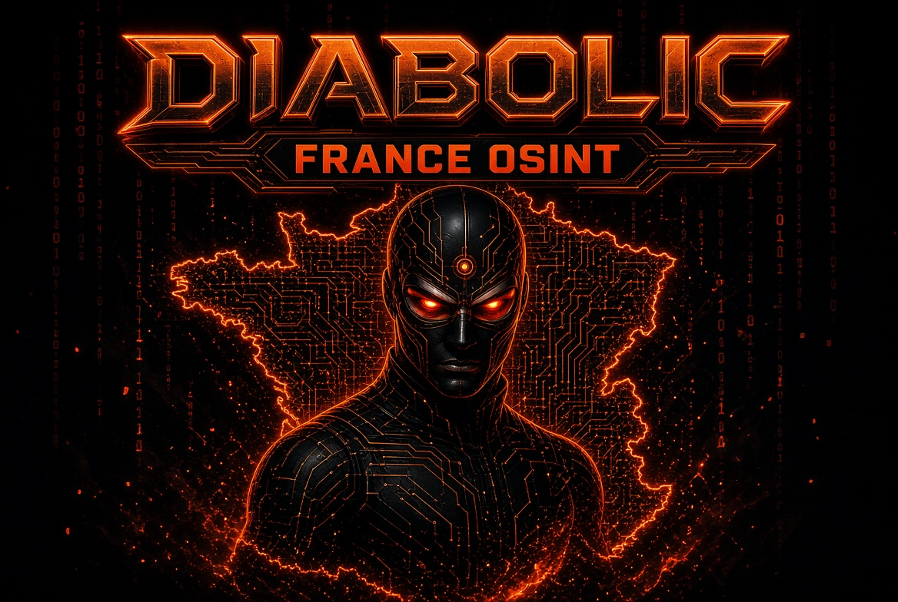
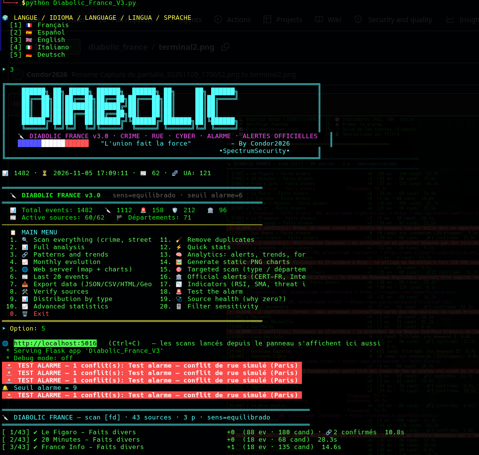
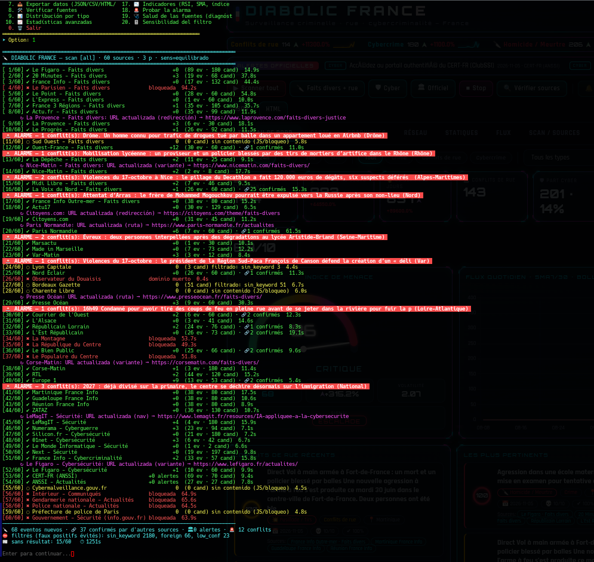
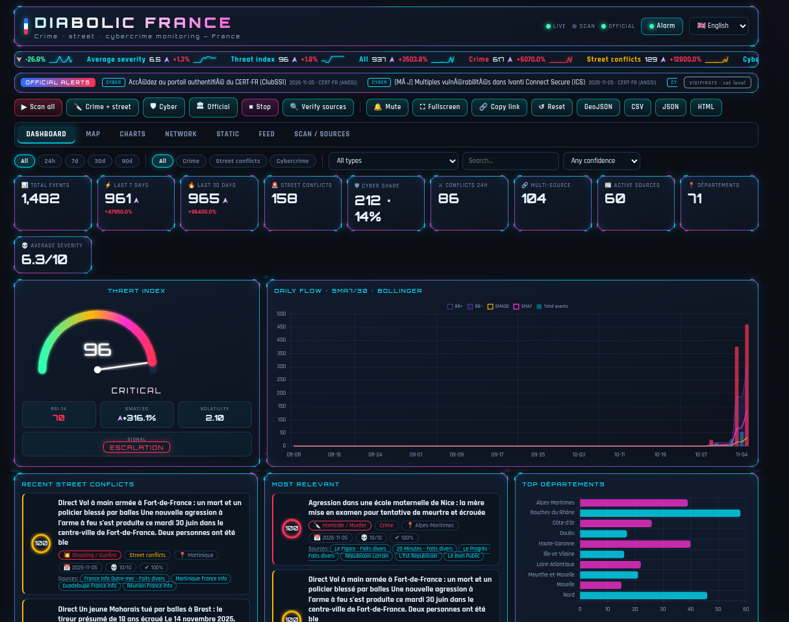
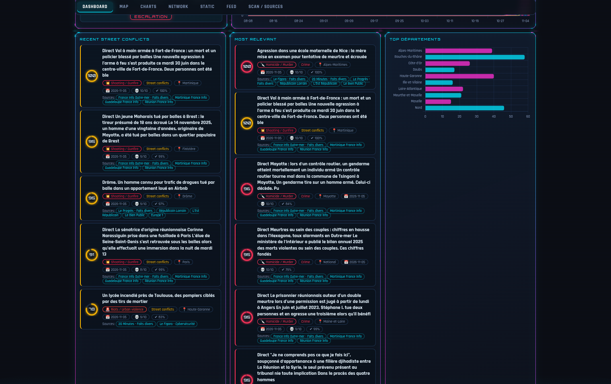
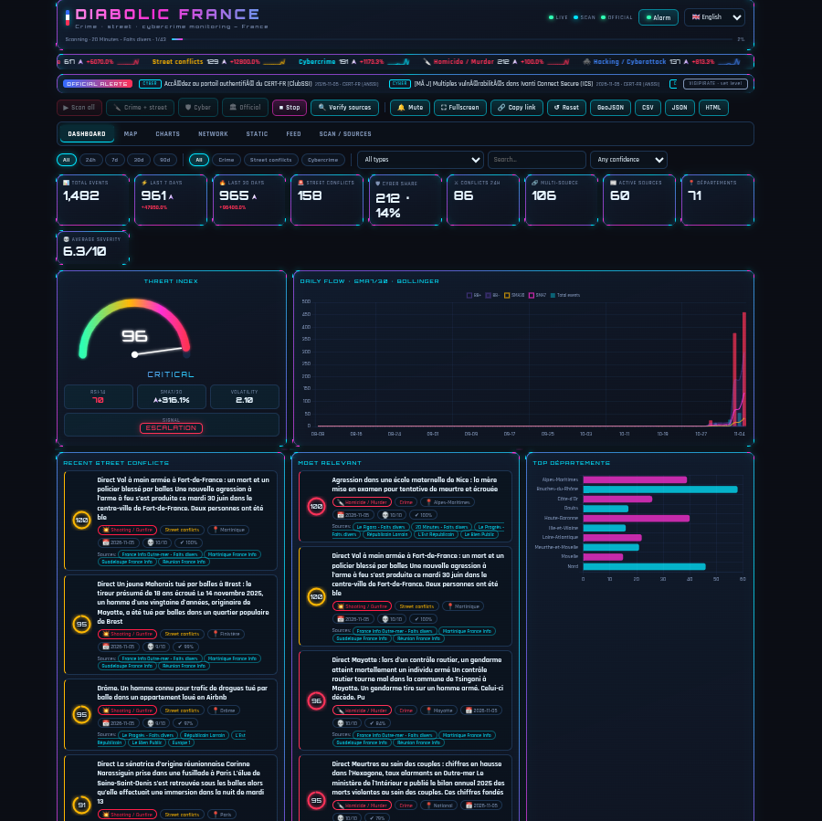

# 🔪 DIABOLIC FRANCE v3.0
<p align="center">
  <!-- Version Badges -->
  
  
  
  
</p>

<p align="center">
  <!-- License Badges -->
  
  
  
</p>

<p align="center">
  <!-- Language Badges -->
  
  
  
  
</p>

<p align="center">
  <!-- Multilanguage Badges -->
  
  
  
  
</p>

<p align="center">
  <!-- Platform Badges -->
  
  
  
</p>

<p align="center">
  <!-- Features Badges -->
  
  
  
</p>

<p align="center">
  <!-- Stats Badges -->
  
  
  
  
</p>

<p align="center">
  <!-- Maintenance Badges -->
  
  
  
  
</p>

<p align="center">
  <!-- Social Badges -->
  
  
  
  
</p>

<p align="center">
  <!-- Fun Badges -->
  
  
  
  
</p>

<p align="center">
  
  
</p>

<h1 align="center">🔪🇫🇷🗼 DIABOLIC FRANCE v3.0</h1>
<h3 align="center">🇫🇷 PLATEFORME DE RENSEIGNEMENT CRIMINEL FRANÇAISE 🇫🇷</h3>
<h3 align="center">🇪🇸 PLATAFORMA DE INTELIGENCIA CRIMINAL FRANCESA 🇪🇸</h3>
<h3 align="center">🇮🇹 PIATTAFORMA DI INTELIGENZA CRIMINALE FRANCESE 🇮🇹</h3>

<p align="center">
  
</p>


**Plateforme de renseignement criminel française — Surveillance · Rue · Cybercriminalité · Alertes officielles**

> By Condor2026 · •SpectrumSecurity• · "L'union fait la force"

---

## Sommaire

- [Qu'est-ce que DIABOLIC FRANCE ?](#quest-ce-que-diabolic-france-)
- [Nouveautés v3.0](#nouveautés-v30)
- [Configuration requise](#configuration-requise)
- [Installation](#installation)
- [Lancement](#lancement)
- [Premier usage](#premier-usage--guide-rapide)
- [Menu terminal](#menu-terminal--20-options)
- [Dashboard web](#dashboard-web--httplocalhost5016)
- [Cartographie 2D](#cartographie-2d-multi-couches)
- [Alarme & conflits de rue](#alarme--conflits-de-rue)
- [Alertes officielles & Vigipirate](#alertes-officielles--vigipirate)
- [Indicateurs type crypto](#indicateurs-type-crypto)
- [Classification & fusion](#classification--comment-un-article-devient-un-événement)
- [Types détectés](#types-détectés-25)
- [API REST](#api-rest)
- [Sources & couverture](#sources--couverture-géographique)
- [Structure du projet](#structure-du-projet)
- [Sécurité](#sécurité--vie-privée)
- [Diagnostic](#diagnostic--pourquoi-0-résultat-)
- [Dépannage](#dépannage)
- [Limitations](#limitations-connues)
- [FAQ](#questions-fréquentes)
- [Licence](#licence)
- [Auteur](#auteur)

---

## Qu'est-ce que DIABOLIC FRANCE ?

DIABOLIC FRANCE est une plateforme d'intelligence criminelle open source conçue pour la France. Elle analyse en temps réel des médias français et des sources officielles pour détecter, classifier et géolocaliser les activités criminelles, les conflits de rue et la cybercriminalité.



| # | Action | Description |
|---|--------|-------------|
| 1 | **Scanne** | 55+ médias français + 8 sources officielles |
| 2 | **Détecte** | Crimes, conflits de rue, cybercriminalité, alertes officielles |
| 3 | **Classifie** | 25 types avec score de confiance et pertinence |
| 4 | **Géolocalise** | Ville, département ou source (101 départements) |
| 5 | **Fusionne** | Une info = plusieurs sources confirmées |
| 6 | **Déclenche** | Alarme sonore pour conflits de rue, alertes Vigipirate |
| 7 | **Analyse** | Statistiques, tendances, prévisions, indicateurs type crypto |
| 8 | **Cartographie** | Carte 2D multi-couches (Carto, OSM, satellite, chaleur, clusters) |
| 9 | **Exporte** | JSON, CSV, HTML, GeoJSON |
| 10 | **Multilingue** | FR · ES · EN · IT · DE |



---

## Nouveautés v3.0

- **Clasificador anti-faux-positifs** + score de confiance + pertinence (0-100)
- **Fusion multi-sources** : une info confirmée par plusieurs sources devient un seul événement
- **Alarme sonore** (armer/couper/tester) + détection de conflits de rue + clusters (≥3 en 24h dans un département)
- **Alertes officielles** : CERT-FR, ANSSI, Cybermalveillance, Intérieur, Gendarmerie, Police, Préfecture de Paris, info.gouv (Vigipirate)
- **Indicateurs type crypto** : RSI(14), SMA7/30, Bollinger, volatilité, momentum, indice de menace 0-100, tickers avec sparklines
- **Analytique** : z-score quotidien, pronostic Holt, mots en tendance, hotspots, réseau type↔département, Sankey
- **Carte 2D** : 6 fonds (Carto dark/light/Voyager, OSM, OSM France, satellite Esri), heatmap, clusters, choroplèthe, hotspots, pulsations, timelapse 30j
- **Auto-discovery d'URL** : si un site change de sous-domaine, de www, de section ou redirige vers la home, la nouvelle URL est retrouvée seule
- **5 langues** : FR · ES · EN · IT · DE
- **Panneau holographique** : cadre animé, ticker type Bourse, flux SSE en direct, terminal intégré
- **Scraping v1 conservé** : séquentiel, 150+ user-agents, 2 essais par source puis on passe à la suivante
- **Sensibilité ajustable** : `amplio` (≈ v1), `equilibrado` (défaut), `estricto`

---

## Configuration requise

| Composant | Minimum | Recommandé |
|-----------|---------|-------------|
| **OS** | Windows 10 / macOS 11 / Linux | Windows 11 / macOS 14 / Ubuntu 22.04 |
| **Python** | 3.8 | 3.11+ |
| **RAM** | 512 MB | 1 GB |
| **Stockage** | 100 MB | 500 MB |
| **Internet** | 1 Mbps | 10 Mbps |

---

## Installation

```bash
# Dépendances obligatoires
pip install flask requests beautifulsoup4

# Optionnel — graphiques statiques PNG
pip install matplotlib networkx
```

---

## Lancement

```bash
# Menu interactif (terminal)
python diabolic_france_v3.py

# Panneau web directement
python diabolic_france_v3.py --web
python diabolic_france_v3.py --web --lang es
python diabolic_france_v3.py --web --port 5016 --host 0.0.0.0

# Scan en ligne de commande puis sortie
python diabolic_france_v3.py --scan fd
python diabolic_france_v3.py --scan cyber --pages 2
python diabolic_france_v3.py --scan gov

# Auto-scan toutes les 30 min (web)
python diabolic_france_v3.py --web --auto 30

# Diagnostic d'une source (pourquoi 0 résultat ?)
python diabolic_france_v3.py --debug-fuente "Le Monde"

# Respect strict de robots.txt (désactivé par défaut, comme la v1)
python diabolic_france_v3.py --web --robots

# Changer la sensibilité du filtre
python diabolic_france_v3.py --web --sens amplio
```

### Options CLI complètes

| Option | Description |
|---|---|
| `--web` | Panneau web direct |
| `--lang {fr,es,en,it,de}` | Langue de l'interface |
| `--host` | Adresse d'écoute (défaut `127.0.0.1`) |
| `--port` | Port (défaut `5016`) |
| `--auto N` | Scan automatique toutes les N minutes |
| `--robots` | Respecter robots.txt |
| `--sens {amplio,equilibrado,estricto}` | Sensibilité du filtre |
| `--scan {all,fd,cyber,gov}` | Scan CLI puis quitte |
| `--pages N` | Pages par source (1-8) |
| `--debug-fuente NOM` | Diagnostic détaillé d'une source |

---

## Premier usage — Guide rapide

### 1. Sélectionner la langue

```
🌍 LANGUE / IDIOMA / LANGUAGE / LINGUA / SPRACHE
  [1] 🇫🇷 Français
  [2] 🇪🇸 Español
  [3] 🇬🇧 English
  [4] 🇮🇹 Italiano
  [5] 🇩🇪 Deutsch
➤ Option : 1
```

### 2. Vérifier les sources (recommandé)

```bash
➤ Option : 8
```

| Action | Description |
|--------|-------------|
| ✅ Vérifie | Les 55+ sources une par une |
| ✅ Marque | Actives = fonctionnent |
| ❌ Marque | Inactives = échouent |
| 🔍 Applique | Auto-discovery aux URLs mortes |

### 3. Scanner

```bash
➤ Option : 1   # Scanner tout
```

### 4. Voir les résultats

```bash
➤ Option : 6   # 20 derniers incidents
```

### 5. Dashboard web

```bash
➤ Option : 5
```

Ouvrir : **http://localhost:5016**

---

## Menu terminal — 20 options

| Opt. | Commande | Description |
|------|----------|-------------|
| **1** | 🔍 Scanner tout | Crimes, rue, cyber, alertes |
| **2** | 📊 Analyse complète | Statistiques détaillées |
| **3** | 🔗 Modèles et tendances | Détecte tendances criminelles |
| **4** | 📈 Évolution mensuelle | Graphique tendance temporelle |
| **5** | 🌐 Serveur web | Dashboard localhost:5016 |
| **6** | 📰 20 derniers événements | Liste des récents |
| **7** | 📥 Exporter données | JSON/CSV/HTML/GeoJSON |
| **8** | 🛠️ Vérifier sources | Auto-discovery + état |
| **9** | 📊 Distribution par type | Pourcentages par catégorie |
| **10** | 📈 Statistiques avancées | Métriques de densité |
| **11** | 🧹 Nettoyer doublons | Fusion multi-sources |
| **12** | ⚡ Statistiques rapides | Résumé express |
| **13** | 🧠 Analytique | Alertes, tendances, pronostic |
| **14** | 🖼️ Graphiques PNG statiques | matplotlib/networkx |
| **15** | 🎯 Scan ciblé | Type / département / source |
| **16** | 🏛️ Alertes officielles | CERT-FR, Intérieur, Vigipirate |
| **17** | 📉 Indicateurs | RSI, SMA, indice de menace |
| **18** | 🚨 Tester l'alarme | Test sirène |
| **19** | 🩺 Santé des sources | Diagnostic des zéros |
| **20** | 🎚️ Sensibilité du filtre | amplio / equilibrado / estricto |
| **0** | 🗑️ Quitter | Ferme l'application |

---

## Dashboard web — `http://localhost:5016`



### Onglets

| Onglet | Contenu |
|---|---|
| **Tableau de bord** | KPIs, jauge d'indice de menace, Bollinger + SMA7/30, conflits de rue, top pertinents, top départements, types, évolution mensuelle, radar, sévérité, pronostic Holt, anomalies z-score, heatmap jour×type, nuage de mots, hotspots |
| **Carte** | 6 fonds + heatmap + clusters + choroplèthe + hotspots + pulsations + timelapse 30j + zoom DOM |
| **Graphiques** | Sankey (catégorie→type→département), hebdomadaire par catégorie, bulles départements (volume×sévérité) |
| **Réseau** | Graphe type ↔ département (vis-network) |
| **Statiques** | PNG serveur (matplotlib/networkx) |
| **Flux** | Liste filtrable/triable/paginée, pertinence, multi-sources, liens |
| **Scan / Sources** | Scans ciblés, terminal en direct, santé des sources, ajout de sources, liens officiels |

### Filtres

- **Période** : tout / 24h / 7j / 30j / 90j
- **Catégorie** : tout / physique / rue / cyber
- **Type** : 25 types classifiés
- **Recherche plein texte**
- **Confiance** : toute / ≥45% / ≥60%
- **Tri** : date / pertinence / sévérité

### Barre d'outils

`▶ Scanner tout` · `🔪 FD+rue` · `🛡 Cyber` · `🏛 Officiel` · `■ Stop` · `🔍 Vérifier sources` · `🔔 Sourdine` · `⛶ Plein écran` · `🔗 Copier le lien` · `↺ Réinitialiser` · Export `GeoJSON/CSV/JSON/HTML`

---

## Cartographie 2D multi-couches

- **6 fonds de carte** : Carto sombre, Plan réel (OpenStreetMap), OSM France, Carto Voyager, Carto clair, Satellite (Esri)
- **Couches** : Chaleur, Clusters, Choroplèthe départements, Hotspots, Pulsations (conflits de rue)
- **Timelapse 30 jours** : animation des événements jour par jour
- **Zoom DOM** : boutons rapides vers les départements d'outre-mer

> ⚠️ Les points sont géolocalisés au niveau ville ou département (approximatif, avec jitter déterministe).

---

## Alarme & conflits de rue


Panneau dédié (bouton `🚨 Alarme`) :

- **Armer / Désarmer** la sirène
- **Tester** l'alarme
- **Couper** la sirène
- **Silence 5 min / 30 min**
- **Volume** (0-100)
- **Seuil de sévérité** (5-9) — un conflit de rue ≥ seuil déclenche l'alarme
- **Type de son** : Sirène / Pulse / Klaxon
- **Notification navigateur** (opt-in)
- **Historique** des alarmes

### Déclencheurs

1. Tout événement `terrorisme`
2. Tout événement `rue` avec sévérité ≥ seuil (défaut 6)
3. **Cluster** : ≥3 conflits de rue en 24h dans le même département

> ⚠️ Le navigateur exige une interaction préalable pour activer l'audio. Cliquez une fois sur **Armer** ou **Test**.

---

## Alertes officielles & Vigipirate

Bandeau défilant en haut du panneau :

- **Badge CYBER** : CERT-FR, ANSSI, Cybermalveillance.gouv.fr
- **Badge SÛRETÉ** : Intérieur, Gendarmerie, Police nationale, Préfecture de police de Paris, info.gouv.fr

Le bouton **VIGIPIRATE** permet de saisir manuellement le niveau en vigueur :

| Niveau | Signification |
|---|---|
| 1 | Vigilance |
| 2 | Sécurité renforcée – risque attentat |
| 3 | Urgence attentat |
| 0 | Inconnu |

> À vérifier sur **info.gouv.fr**.

---

## Indicateurs type crypto

| Indicateur | Calcul | Interprétation |
|---|---|---|
| **RSI(14)** | Wilder sur compte quotidien | >70 escalade · <30 apaisement |
| **SMA7 / SMA30** | Moyennes mobiles | Croisement = tendance |
| **Bollinger** | SMA20 ± 2σ | Sortie de bande = anomalie |
| **Momentum** | (SMA7/SMA30 − 1)×100 | >+15% escalade · <−15% apaisement |
| **Volatilité** | σ/μ sur 14j | Instabilité |
| **Indice de menace** | 38 + 16×z (borné) + 3×(sévérité−4) + 14×part de rue | 0-25 calme · 25-50 vigilance · 50-75 tendu · 75-100 critique |
| **Signal** | RSI + momentum | ESCALADE / APAISEMENT / NEUTRE |

Le **ticker** en haut du panneau affiche en continu : indice de menace, total 7j, physique/rue/cyber, top types, RSI, sévérité moyenne — avec delta % et sparkline 14j.

---



## Classification — comment un article devient un événement

1. **Nettoyage** : normalisation Unicode/ASCII, suppression des apostrophes/tirets
2. **Scrub** : neutralisation des usages non criminels (vols de nuit, bandes dessinées, incendies de forêt, tensions diplomatiques…)
3. **Scoring** : pour chaque type, mots « forts » (suffisent seuls) et « faibles » (exigent un indice policier/judiciaire)
4. **Pondération** : mot dans le titre ×1.5, poids du type, sévérité
5. **Anti-faux-positifs** :
   - `foreign` (Ukraine, Gaza, USA…) sans mention France → rejeté
   - `sport` (Ligue 1, PSG…) sans type compatible → rejeté
   - `culture` (film, série…) sans indice policier → rejeté
   - `accident` (route, noyade…) sans mot fort → rejeté
   - `advice` / `vuln` (conseils, CVE, patch…) sans impact → rejeté
   - `nav` (abonnez-vous, cookies…) → rejeté
6. **Confiance** : base 45 (fort) ou 30 (faible) + 10 titre + 10 indice policier + 10 géoloc − pénalités
7. **Seuil** selon sensibilité : `amplio` 20 · `equilibrado` 45 · `estricto` 60
8. **Pertinence** (0-100) = 4.5×sévérité + 0.25×confiance + 20×(sources-1)/3 + 10×fraîcheur

### Fusion multi-sources

Deux événements sont fusionnés si :
- Similarité Jaccard des tokens du titre ≥ **0.8**, ou
- ≥ **0.5** + même catégorie + ≤3 jours d'écart + même département (ou département inconnu d'un côté)

À la fusion :
- Les sources s'additionnent (`fuentes[]`)
- Confiance **+8** par nouvelle source (max 100)
- Sévérité = max des deux
- URL conservée si absente

---

## Types détectés (25)

### Crime physique (11)

| Icône | Type | Sévérité |
|---|---|---|
| 🔪 | Homicide / Meurtre | 8 |
| 💣 | Terrorisme / Attentat | 9 |
| ⚠️ | Viol / Agression sexuelle | 7 |
| 🔫 | Braquage / Hold-up | 6 |
| 👥 | Gang / Règlement de comptes | 6 |
| ⛓️ | Enlèvement / Séquestration | 6 |
| 👊 | Violence / Agression | 4 |
| 🔥 | Incendie criminel | 4 |
| 💊 | Narcotrafic / Drogue | 4 |
| 🚪 | Cambriolage / Vol | 3 |
| 💼 | Escroquerie / Fraude | 3 |

### Conflits de rue (6)

| Icône | Type | Sévérité |
|---|---|---|
| 🚨 | Émeutes / Violences urbaines | 7 |
| 🥊 | Rixe / Bagarre | 5 |
| 💥 | Fusillade / Tirs | 8 |
| 🛡️ | Attaque contre forces de l'ordre / secours | 6 |
| 📢 | Manifestation violente / Casseurs | 4 |
| 🏍️ | Rodéo urbain / Refus d'obtempérer | 3 |

### Cybercriminalité (7)

| Icône | Type | Sévérité |
|---|---|---|
| 🔐 | Ransomware / Rançongiciel | 7 |
| 💧 | Fuite de données | 6 |
| 🌐 | DDoS / Déni de service | 4 |
| 🎣 | Phishing / Hameçonnage | 3 |
| 💳 | Arnaque en ligne | 3 |
| 🧷 | Cyberharcèlement | 4 |
| 🕷️ | Piratage / Cyberattaque | 5 |

---



## API REST

| Méthode | Route | Description |
|---|---|---|
| `GET` | `/api/stats` | Statistiques filtrées |
| `GET` | `/api/analytics` | Anomalies, pronostic, tendances, hotspots |
| `GET` | `/api/indicators` | RSI, SMA, Bollinger, indice de menace, tickers |
| `GET` | `/api/geo` | Points géolocalisés + hotspots |
| `GET` | `/api/network` | Graphe type↔département |
| `GET` | `/api/sankey` | Flux Sankey |
| `GET` | `/api/crimes` | Liste paginée/triée |
| `GET` | `/api/alerts` | Alertes officielles + Vigipirate |
| `GET` | `/api/sources` | État des sources |
| `GET` | `/api/status` | État du job en cours |
| `GET` | `/stream` | SSE : log + job + alarme |
| `POST` | `/api/scan` | Lance un scan `{scope, paginas, sens}` |
| `POST` | `/api/scan/stop` | Arrête le scan |
| `POST` | `/api/verify` | Vérifie/auto-découvre les sources |
| `POST` | `/api/sources/toggle` | Active/désactive une source |
| `POST` | `/api/sources/add` | Ajoute une source |
| `POST` | `/api/vigipirate` | Définit le niveau Vigipirate |
| `POST` | `/api/alarm/test` | Teste l'alarme |
| `POST` | `/api/alarm/config` | Définit le seuil |
| `GET` | `/api/alarm/history` | Historique des alarmes |
| `GET` | `/graph/{kind}.png` | PNG statique (`tipos`, `mensual`, `heatmap`, `hexbin`, `red`) |
| `GET` | `/exportar/{fmt}` | Export (`json`, `csv`, `html`, `geojson`) |

> Les POST exigent l'en-tête `X-DF: 1`.

---

## Sources & couverture géographique

### Sources (62 par défaut)

- **45 médias faits divers** : Le Monde, Le Figaro, Libération, 20 Minutes, France Info, Le Parisien, Le Point, L'Express, France 3 Régions, Actu.fr, La Provence, Le Progrès, Sud Ouest, Ouest-France, La Dépêche, Nice-Matin, Midi Libre, La Voix du Nord, France Info Outre-mer, Actu17, Citoyens.com, Paris Normandie, Marsactu, Made in Marseille, Var-Matin, Lyon Capitale, Nord Éclair, Observateur du Douaisis, Bordeaux Gazette, Charente Libre, Presse Océan, Courrier de l'Ouest, L'Alsace, Républicain Lorrain, L'Est Républicain, La Montagne, La République du Centre, Le Bien Public, Le Populaire du Centre, Corse-Matin, RTL, Europe 1, Martinique/Guadeloupe/Réunion France Info
- **9 médias cyber** : ZATAZ (RSS), LeMagIT, Numerama Cyberguerre, Silicon.fr, 01net, Le Monde Informatique, Next.ink (RSS), France Info Cybercriminalité, Le Figaro Cybersécurité
- **8 sources officielles** : CERT-FR (RSS), ANSSI, Cybermalveillance.gouv.fr, Intérieur, Gendarmerie nationale, Police nationale, Préfecture de police de Paris, info.gouv.fr (Vigipirate)

**Ajout de sources** : depuis l'onglet *Scan / Sources* du panneau (nom, URL, type, département) — persistées dans `estado_fuentes_crime.json`. Vous pouvez aussi activer/désactiver chaque source d'un clic.

**Auto-discovery** : si une source change de sous-domaine, de `www`, de section ou redirige vers la home, l'outil retrouve automatiquement la nouvelle URL (variantes → liens de la home → chemins v1), et met le résultat en cache dans `url_cache_crime.json`. Les sources qui échouent après 2 essais sont signalées dans **Santé des sources**.

### Couverture géographique

| Région | Départements | Sources |
|---|---|---|
| **France métropolitaine** | 96 | ~50 |
| **Outre-mer** | 5 | ~5 |
| **Sources officielles** | - | 8 |
| **TOTAL** | **101** | **62** |

### Principaux départements couverts

| Département | Sources | Médias principaux |
|---|---|---|
| **Paris (75)** | 16+ | Le Monde, Le Figaro, Libération, Le Parisien |
| **Bouches-du-Rhône (13)** | 4 | La Provence, Marsactu, Made in Marseille |
| **Rhône (69)** | 3 | Le Progrès, Lyon Capitale |
| **Alpes-Maritimes (06)** | 2 | Nice-Matin |
| **Gironde (33)** | 3 | Sud Ouest, Bordeaux Gazette |
| **Haute-Garonne (31)** | 3 | La Dépêche |
| **Nord (59)** | 3 | La Voix du Nord, Nord Éclair |
| **Bas-Rhin (67)** | 3 | L'Alsace, Républicain Lorrain |
| **Loire-Atlantique (44)** | 3 | Ouest-France, Presse Océan |
| **Var (83)** | 2 | Var-Matin |
| **Corse (2A/2B)** | 2 | Corse-Matin |

---

## Structure du projet

```
diabolic_france/
│
├── 📄 diabolic_france_v3.py           # Script principal (3000+ lignes)
├── 📄 README.md                       # Ce document
├── 📄 LICENSE                         # GPL v3
│
├── 📊 diabolic_france.json            # Base de données des incidents
├── 💾 diabolic_france_backup.json     # Sauvegarde automatique
├── 🗺️ url_cache_crime.json            # Cache URLs découvertes
├── 📡 estado_fuentes_crime.json       # État de chaque source
├── 📝 diabolic_france.log             # Journal complet
│
└── 📁 graficos_estaticos/             # PNG générés (menu option 14)
```

---

## Fichiers générés

| Fichier | Rôle |
|---|---|
| `diabolic_france.json` | Base principale (compatible v1/v2, migration automatique) |
| `diabolic_france_backup.json` | Sauvegarde avant chaque écriture |
| `diabolic_france.log` | Journal complet |
| `url_cache_crime.json` | URLs auto-découvertes |
| `estado_fuentes_crime.json` | État des sources + sources ajoutées |
| `graficos_estaticos/` | PNG générés par le menu (option 14) |

---

## Sécurité & vie privée

- **Aucune donnée personnelle** collectée : uniquement des titres d'articles publics et des liens
- **POST protégés** par header `X-DF: 1` → une page web tierce ne peut pas déclencher scans/alarmes sur votre `localhost`
- **CSV injection-safe** : les cellules commençant par `= + - @` sont préfixées par `'`
- **Liens http(s) uniquement** (pas de `javascript:`/`data:`)
- **`X-Content-Type-Options: nosniff`**, `Referrer-Policy: no-referrer`
- **Pas de `Retry-After` bloquant** : une source qui répond « attends 1h » ne gèle pas le scan
- **DNS cache** : un domaine mort ne coûte plus 6 essais
- **Budget 90s/source** : aucune source ne peut bloquer le scan global
- **robots.txt ignoré par défaut** (comme la v1), activable avec `--robots`

---

## Diagnostic « pourquoi 0 résultat ? »

```bash
python diabolic_france_v3.py --debug-fuente "Le Monde"
```

Affiche pour **une** source :
- URL finale et statut HTTP
- Nombre de candidats récoltés
- Pour chaque candidat : `✔ type conf sev titre` ou `✖ motif_rejet titre`
- Si l'URL est morte : résultat de l'auto-discovery

L'onglet **Scan / Sources** du panneau affiche aussi la **santé des sources** : `OK` / `0 résultat` / `Domaine mort` / `Bloquée` / `URL disparue` / `Erreur`, avec la raison du filtrage (`filtrado: foreign 3, sport 2`…).

---

## Dépannage

### Erreur "Module not found"

```bash
pip install flask requests beautifulsoup4
```

### Aucune source active

```bash
Option 8 (Vérifier sources) → Auto-discovery actif
```

### Port 5016 déjà utilisé

```python
# Dans diabolic_france_v3.py
PUERTO = 5017  # Changer le port
```

Ou en CLI :

```bash
python diabolic_france_v3.py --web --port 5017
```

### Sites protégés par JS lourd

Les sites avec challenge Cloudflare ou rendu client peuvent renvoyer 0 article — l'outil le signale (`sin contenido (JS/bloqueo)`).

---

## Limitations connues

- **Sites protégés par JS lourd** (Cloudflare challenge, rendu client) peuvent renvoyer 0 article — l'outil le signale
- **Sites payants** peuvent bloquer après quelques requêtes (`blocked`)
- **Fusion** : peut regrouper deux affaires distinctes si les titres sont très proches et le même jour/département
- **Géolocalisation approximative** au niveau ville ou département (jitter déterministe)
- **Alarme audio** : nécessite une interaction utilisateur préalable (politique navigateur)
- **Vigipirate** : saisi manuellement, non scrapé (la source officielle ne publie pas de niveau machine-readable)
- **`--robots`** : certains sites bloquent alors tout (comportement attendu)

---

## Questions fréquentes

### Est-ce légal ?

**Oui.** Accès aux données **publiques** uniquement, respect des délais, pas de contournement de sécurité. Projet éducatif / OSINT défensif.

### Puis-je adapter à un autre pays ?

**Oui.** Modifier `_DEPS_RAW`, `_CITIES_RAW`, `_FUENTES_RAW`, `_FUENTES_CYBER_RAW`, `_FUENTES_GOV_RAW` et `_TIPOS`.

### Les 5 langues sont-elles complètes ?

**Oui.** Terminal, web, graphiques et exports 100% traduits.

### Ça consomme beaucoup de ressources ?

**Non.** RAM: ~200-500 MB, Stockage: ~10-50 MB par mois.

### Pourquoi 0 résultat sur une source ?

Lancez `--debug-fuente "Nom"` ou consultez l'onglet **Santé des sources**. Causes fréquentes : site en JS, blocage, URL changée (l'auto-discovery la retrouve), ou filtrage anti-faux-positifs (la raison est affichée).

---

## Licence

**GNU General Public License v3.0**

```
Copyright (C) 2026 Condor2026 / SpectrumSecurity

This program is free software: you can redistribute it and/or modify
it under the terms of the GNU General Public License as published by
the Free Software Foundation, either version 3 of the License, or
(at your option) any later version.
```

| Action | Permis |
|---|---|
| ✅ Usage commercial | Oui |
| ✅ Modification | Oui |
| ✅ Distribution | Oui |
| ❌ Responsabilité | Non |

---

## Auteur

**Condor2026** · **SpectrumSecurity**

| Plateforme | Lien |
|---|---|
| **GitHub** | [@Condor2026](https://github.com/Condor2026) |
| **Projet** | [DIABOLIC FRANCE](https://github.com/Condor2026/diabolic_france) |
| **Email** | SpectrumSecIt@proton.me |

---

## ⭐ Donnez une étoile

Si ce projet vous a été utile, pensez à lui donner une ⭐ sur GitHub.

---

<p align="center">
  <b>🛡️ "Un grand pouvoir implique de grandes responsabilités"</b><br>
  <i>Data-driven intelligence for public safety awareness</i>
</p>

<p align="center">
  <i>🔪 DIABOLIC FRANCE — Vigilamus pro tuendo (Nous surveillons pour protéger)</i>
</p>
